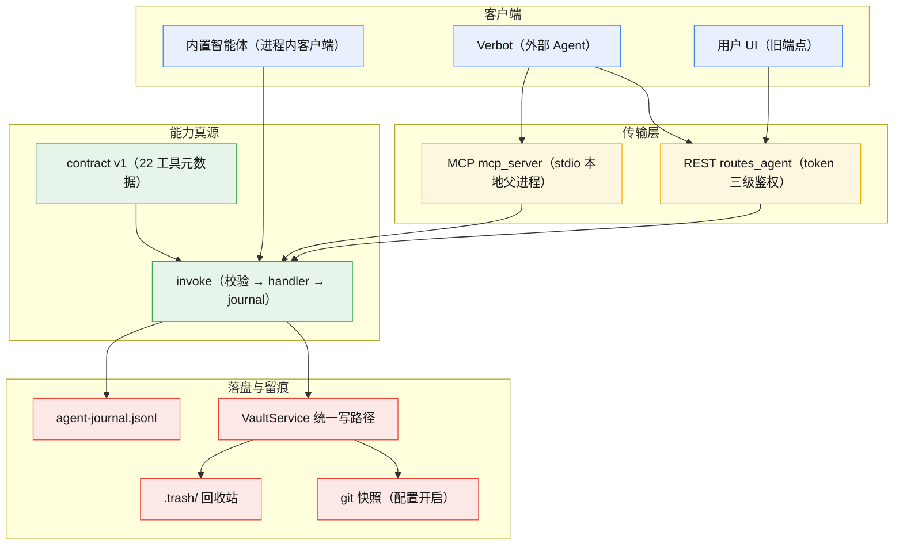

# Kwey 能力契约（Agent Contract v1）

状态：已冻结。真源：`app/agent/registry.py`（`CONTRACT_VERSION = 1`）。
本文档与真源一一对应；实现偏离本文档时，以修正实现并回写本文档为准。

## 1. 定位与范围

### 1.1 单一能力真源

选定方案：全部 Kwey 内操作收敛为一张工具注册表（registry），传输层只做鉴权与
响应 framing，能力语义一律经 `registry.invoke`。理由：内置智能体与外部 Agent
（Verbot）共享同一语义，杜绝「两套实现、两种行为」的漂移；新增能力只改一处。

放弃方案：为 Verbot 制定对等协议（peer protocol）。理由：Kwey 已有 MCP stdio 与
REST + SSE 两条成熟通道，新增线缆协议只增加维护面，不增加能力。

### 1.2 客户端与传输

| 客户端 | 接入方式 | 鉴权 | journal actor |
|---|---|---|---|
| 内置智能体（卡B，未落地） | 进程内直接调用 `invoke` | 进程内信任 | 调用方显式传入 |
| Verbot（外部 Agent） | REST `POST /api/agent/tool` | token 三级 | token 记录 `{role, name}` |
| Verbot（外部 Agent） | MCP stdio `tools/call` | 本机父进程信任 | `{role: admin, name: mcp-stdio}` |
| 用户 UI / 旧端点 | REST 旧端点（§7.3） | token 三级 | token 记录 `{role, name}` |

### 1.3 不变式

1. v1 内只增不改（additive-only）：新增工具、新增缺省参数允许；改名、删字段、
   改必填、改语义禁止。
2. 全部写操作经 `VaultService` 统一写路径（锁、原子写、重索引、事件、快照挂钩）。
3. 路径一律 vault 相对正斜杠；越界路径在边界拒绝。
4. journal 与 git 快照是增强能力：二者失败只记日志，绝不阻断写盘。
5. `invoke` 在 `actor=None` 时不写 journal（进程内纯调用与测试保持无副作用留痕）。

## 2. 工具矩阵（22）

### 2.1 元数据字段

| 字段 | 取值 | 语义 |
|---|---|---|
| `name` | `kwey.*` | 工具唯一名 |
| `description` | 非空字符串 | 面向 LLM 的用途说明 |
| `input_schema` | JSON Schema object | 边界校验依据（§2.5） |
| `permission` | `read` / `write` / `admin` | REST 所需 token 等级 |
| `side_effect` | `read` / `reversible` / `irreversible` | 副作用分级（§6） |
| `journal_action` | 动作字符串 / `null` | 留痕动作；读工具为 `null` |

### 2.2 读工具（8）

统一元数据：`permission=read`，`side_effect=read`，`journal_action=null`。

| 名称 | 用途 | 必填参数 | 缺省参数 |
|---|---|---|---|
| `kwey.search` | FTS5 BM25 全文搜索，支持 `path:`/`tag:`/`file:` 操作符，返回 `hits` | `query`（空串为纯过滤浏览） | `limit=50`（1-200），`mode="fts"`（enum：fts/hybrid） |
| `kwey.read` | 读笔记正文（默认最多 8000 字符）；返回 `path/title/content/frontmatter/mtime/offset/total_chars/truncated` | `path` | `offset=0`（0-1000000），`max_chars=8000`（1-40000） |
| `kwey.open` | 让界面打开笔记 / 定位目录（只返回 `path/kind`，不回传正文） | `path` | 无 |
| `kwey.graph.query` | 内存 LinkGraph 双向 BFS 邻域 | `path` | `depth=1`（1-5） |
| `kwey.organize` | 自然语言整理预演（纯计算不落盘），需配置 Provider | `instruction` | `paths` 缺省全库 |
| `kwey.tree` | 嵌套文件树（隐藏 `.kwey/.trash/.git`，目录在前） | 无 | 无 |
| `kwey.trash.list` | 回收站顶层条目（`trash_path/original_path/name/is_dir/mtime`，mtime 倒序） | 无 | 无 |
| `kwey.history.log` | git 快照时间线，返回 `entries`（快照关闭时为空数组） | 无 | `path` 缺省全库，`limit=50`（1-200） |

### 2.3 写工具（13）

统一元数据：`permission=write`，`side_effect=reversible`（回收站、链接重写、
快照留存三者保障可恢复）。

| 名称 | 用途 | 必填参数 | 缺省参数 | journal_action |
|---|---|---|---|---|
| `kwey.create` | 新建笔记（已存在 409） | `path` | `content` 缺省生成标题行，`frontmatter` 缺省 `{}` | `create` |
| `kwey.write` | 覆盖写正文（允许空串清空） | `path`、`content` | `frontmatter` 缺省保留磁盘现值，`base_mtime` 缺省不加锁（传入则冲突 409） | `update` |
| `kwey.delete` | 删除笔记入 `.trash/` | `path` | 无 | `delete` |
| `kwey.link` | 源笔记末尾追加 `[[to]]` | `from`、`to` | 无 | `link` |
| `kwey.tags` | 增删 frontmatter.tags（保序去重） | `path` | `add`/`remove` 缺省 `[]`（兼容单字符串） | `tags` |
| `kwey.append` | 正文末尾追加文本（原文一字不改，独立成行） | `path`、`text` | 无 | `append` |
| `kwey.move` | 移动到目标目录（basename 不变，全库链接重写） | `path`、`target`（空串 = 根目录） | 无 | `move` |
| `kwey.rename` | 同目录重命名（自动补 `.md`，全库链接重写） | `path`、`name` | 无 | `rename` |
| `kwey.dir.create` | 新建目录含父级（已存在 409） | `path` | 无 | `mkdir` |
| `kwey.dir.delete` | 整目录入 `.trash/` | `path` | `confirm=false`（非空目录必须 true，§6） | `rmdir` |
| `kwey.trash.restore` | 回收站恢复（目标已存在自动去重不覆盖） | `trash_path` | `target_path` 缺省回原路径 | `restore` |
| `kwey.history.rollback` | 回滚到指定快照（自动留存回滚前 commit） | `hash`、`path` | `confirm=false`（必须 true，§6） | `rollback` |
| `kwey.organize.apply` | 应用结构化 ops（create/append/tag/link/move/delete） | `ops`（对象数组） | `confirm=false`（必须 true，§6） | `organize` |

### 2.4 管理工具（1）

统一元数据：`permission=admin`，`side_effect=irreversible`。

| 名称 | 用途 | 必填参数 | 缺省参数 | journal_action |
|---|---|---|---|---|
| `kwey.trash.purge` | 永久删除回收站条目（真实 unlink/rmtree，不可恢复） | 无 | `trash_path` 缺省清空全部，`confirm=false`（必须 true，§6） | `purge` |

### 2.5 参数类型与边界校验

`_validate` 在 handler 之前执行，规则如下：

| 规则 | 行为 |
|---|---|
| required 缺失、值为 `None` | `ContractError(400, "缺少必填参数 {key}")` |
| 类型不符（string/integer/number/boolean/object/array，含类型列表如 `["array","string"]`） | `ContractError(400)` |
| 数组元素类型不符（`items.type`） | `ContractError(400)` |
| enum 越界 | `ContractError(400)` |
| 数值越界（minimum/maximum） | `ContractError(400)` |
| 缺省参数传 `None` | 视同未传（沿用 MCP 旧行为） |
| 未知键 | 放行（JSON Schema additionalProperties 默认 true） |
| `arguments` 非对象 | `ContractError(400, "arguments 必须是对象")` |

非空字符串等业务约束留在 handler 内（`_req_str`），不在 schema 边界重复。
`integer`/`number` 校验排除 `bool`（Python `bool` 是 `int` 子类）。

## 3. 调用流水线

### 3.1 流程图



### 3.2 invoke 签名与执行序

```python
def invoke(name, arguments, vault=None, actor=None) -> Any
```

执行序（任一失败即中止，不留痕）：

1. 查表：未知工具 → `ContractError(404)`。
2. `arguments` 为 `None` 视同 `{}`；非 dict → `ContractError(400)`。
3. `_validate(input_schema, arguments)`（§2.5）。
4. 取服务：`vault` 注入优先，缺省 `deps.require_vault()`（未打开 vault → 400）。
5. 执行 handler（业务异常 `HTTPException` 原样上抛）。
6. 成功后：`journal_action` 非空且 `actor` 非 `None` 时逐路径 `journal.append`。
7. 返回 handler 数据（传输层负责 framing）。

### 3.3 错误模型

| 场景 | 契约层异常 | REST 状态码 | MCP 映射 |
|---|---|---|---|
| 未知工具 | `ContractError(404)` | 404（仅对已鉴权调用方暴露） | 传输层预检 → `isError` code=-1 |
| 缺必填 / 类型 / enum / 范围 / 非对象 arguments | `ContractError(400)` | 400 | JSON-RPC `-32602` |
| confirm 闸门未确认（rollback/purge/organize.apply） | `ContractError(400)` | 400 | JSON-RPC `-32602` |
| 笔记 / 目录 / 回收站条目不存在 | `HTTPException(404)` | 404 | `isError` code=404 |
| 已存在 / mtime 冲突 / 非空目录未确认 | `HTTPException(409)` | 409 | `isError` code=409 |
| vault 未打开 | `HTTPException(400)` | 400 | `isError` code=400 |
| 权限不足 | 传输层判定 | 403 | 不适用（stdio 无鉴权） |
| token 缺失 / 失效 | 传输层判定 | 401 | 不适用 |
| 其它异常 | 原样上抛 | 500 | `isError` code=500 |
| MCP 未知 method | 不适用 | 不适用 | JSON-RPC `-32601` |
| MCP 请求结构非法 | 不适用 | 不适用 | JSON-RPC `-32600` |

MCP `handle()` 绝不抛穿；工具成功结果 `content[0].text` 为项目统一内部响应
`{"code":0,"data":...,"message":"ok"}`，失败时 `code` 取 HTTP 状态码、`data=null`、
`isError=true`。

## 4. 鉴权与权限

### 4.1 REST token 三级

token 取 `X-Kwey-Token` 头，缺省取 `Authorization: Bearer <token>`。
等级：`read=1`，`write=2`，`admin=3`（`ROLE_LEVEL`）。签发 / 吊销 / 列表经
`POST /api/agent/tokens`（admin 专用），存储 `TokenStore`（vault 内磁盘 + 全局锁）。

### 4.2 /tool 双重校验

选定方案：先验 read 级 token，再按工具 `permission` 二次校验。理由：未知工具
对无 token 者不暴露（404 仅对已鉴权调用方返回），避免能力清单被未授权探测。

判定序：无 token → 401；`ROLE_LEVEL[rec.role] < ROLE_LEVEL[tool.permission]` → 403；
未知工具 → 404；其余进入 `invoke`。

### 4.3 MCP stdio 信任模型

stdio 是本机父子进程私有管道，调用方即启动者，不设 token 鉴权，actor 固定
`{role: admin, name: mcp-stdio}`。改为 WS/SSE、对外开放网络端口时必须引入鉴权
（ARCHITECTURE T11 既定约束）。

## 5. journal 留痕

### 5.1 actor 注入

| 调用方 | actor | 留痕 |
|---|---|---|
| REST 旧端点 / `/tool` | token 记录 `{role, name}` | 写工具成功后 |
| MCP stdio `tools/call` | `{role: admin, name: mcp-stdio}` | 写工具成功后 |
| 进程内 `invoke(actor=None)` | 无 | 不留痕 |

### 5.2 动作与路径映射

- 动作取工具 `journal_action`（§2.3 / §2.4 表）。
- 路径取 `args.path`，缺省依次取 `args.from`、`args.trash_path`，再缺省为空串。
- `kwey.organize.apply` 特例：按返回 `data["paths"]` 逐条留痕（一次应用多条 ops
  对应多条 journal，评审台可逐路径归因）。

### 5.3 存储与上限

文件 `.kwey/agent-journal.jsonl`；条目 `{ts, role, name, action, path}`；上限 500
条（超出裁旧）；原子写（tmp + replace）+ 全局锁；读写失败只记日志。
数据消费方：脉冲首页活动 strip（`GET /api/pulse`）与未来评审台。

## 6. confirm 闸门与副作用分级

副作用分级：`read` 无落盘；`reversible` 经回收站、链接重写、快照留存可恢复；
`irreversible` 真实抹除。危险操作必须显式确认：

| 工具 | 闸门条件 | 未确认响应 | 确认后行为 |
|---|---|---|---|
| `kwey.history.rollback` | `confirm=true` | `ContractError(400)` | 回滚正文，自动留存 before rollback commit |
| `kwey.trash.purge` | `confirm=true` | `ContractError(400)` | 真实删除单条、清空全部 |
| `kwey.organize.apply` | `confirm=true` | `ContractError(400)` | 逐项应用 ops（先经 `kwey.organize` 预演） |
| `kwey.dir.delete` | 非空目录需 `confirm=true` | `HTTPException(409)` | 整目录入 `.trash/`（空目录无需 confirm） |

快照服务经 `deps.require_snapshots()` 单例取得：`enabled` 实时读配置（缺省
`false`，不擅自 git init 用户 vault），开启时自动 `ensure_repo`。统一写路径的
auto_commit 挂钩独立读配置，快照失败不阻断写盘。

## 7. 传输层映射

### 7.1 REST 端点

| 端点 | 等级 | 语义 |
|---|---|---|
| `GET /api/agent/contract` | read | 契约快照（version + 22 工具元数据，不含 handler） |
| `POST /api/agent/tool` | read + 工具级 | 通用工具入口 `{name, arguments}` |
| `GET /api/agent/health` | read | vault 信息 + 调用方 role |
| `GET /api/agent/search` | read | `kwey.search` + `elapsed_ms` |
| `GET /api/agent/note` | read | `kwey.read` |
| `POST /api/agent/note` | write | `kwey.create` |
| `PUT /api/agent/note` | write | `kwey.write` |
| `DELETE /api/agent/note` | write | `kwey.delete` |
| `POST /api/agent/link` | write | `kwey.link`（target 经 `normalize_rel`） |
| `POST /api/agent/tags` | write | `kwey.tags` |
| `GET /api/agent/graph` | read | 旧版邻域子图（独立能力，非 `kwey.graph.query`） |
| `GET /api/agent/events` | read | SSE 事件流（EventBus 跨线程投递） |
| `POST /api/agent/tokens` | admin | issue / revoke / list |
| `GET /api/history/status`、`/log`、`/show` | 会话 | 快照状态 / 时间线 / 历史原文 |
| `POST /api/history/rollback` | 会话 | confirm=true 闸门 + `deps.require_snapshots().rollback` |

统一响应 `{"code":0,"data":...,"message":"ok"}`；错误经 server.py 异常处理器包装。

### 7.2 MCP 方法

| 方法 | 行为 |
|---|---|
| `initialize` | serverInfo name=kwey |
| `notifications/initialized` | 空响应 |
| `tools/list` | 由 `registry.contract()` 派生（`input_schema` → `inputSchema`），22 工具 |
| `tools/call` | 名称 / 必填预检 → `registry.invoke(actor=MCP_ACTOR)` |
| `resources/list` | 索引内全部笔记 → `kwey://note/<path>` 资源 |
| `resources/read` | 字节级原文（读操作允许直接读盘，ARCHITECTURE §8.3） |
| `ping` | 空响应 |

### 7.3 旧端点 parity 键

| 端点 | 保留键 | 理由 |
|---|---|---|
| `POST /api/agent/link` | `linked_to`（= canonical `link`） | M2 既有客户端兼容 |
| `DELETE /api/agent/note` | `path` + `trash_path` | M2 既有客户端兼容 |
| `GET /api/agent/search` | `elapsed_ms` | 传输层计时，非能力语义 |
| `GET /api/agent/graph` | `nodes/edges` 子图视图 | 与 `kwey.graph.query` 是不同能力，保持独立 |

## 8. 版本演进规则

1. `CONTRACT_VERSION` 当前为 1；v1 生命周期内执行 §1.3 不变式 1。
2. 破坏性变更（改名、删字段、改必填、改语义）必须升版本号；旧版协商机制在
   升版时一并落地，v1 内不预留兼容垫片。
3. 新增工具必须同时补齐：元数据六字段、schema 边界、矩阵测试
   （`tests/test_contract_matrix.py` 自动参数化覆盖）、本文档 §2 表行。
4. 本文档 mermaid 图锁定 ≤8.8.3 语法，经 `validate_mermaid.cjs` 解析 0 ERROR。

## 9. 验证证据与复现

### 9.1 测试矩阵

| 文件 | 覆盖 | 用例数 |
|---|---|---|
| `tests/test_contract.py` | W1：契约形状、invoke 往返、校验矩阵、MCP/REST 错误映射、旧端点 parity | 41 |
| `tests/test_contract_w2.py` | W2：12 新工具行为、confirm 闸门、journal actor、权限矩阵 | 21 |
| `tests/test_contract_matrix.py` | W3：22 工具元数据不变式、MCP schema parity、REST 权限全矩阵、schema 边界 | 165 |
| `tests/test_m2_mcp.py`、`tests/test_m2_snapshots.py` | M2 回归（工具数断言演进 9 → 21） | 计入全量 |

全量：`py -m pytest -q` → 564 passed（W2 基线 399 + W3 矩阵 165）。

### 9.2 冒烟

| 轮次 | 脚本 | 环境 | 结果 |
|---|---|---|---|
| W1 | `.workbuddy/w1_smoke.py` | 克隆 vault，端口 17642 + stdio 子进程 | 28/28 PASS |
| W2 | `.workbuddy/w2_smoke.py` | 克隆 w2-smoke-vault，端口 17643 + stdio w2-stdio-vault | 50/50 PASS |

冒烟覆盖：stdio tools/list 21、契约 tiers 7/13/1、权限矩阵 403、confirm 闸门
400/409、回收站删-列-恢-清全流程、move/rename 链接重写、journal actor 归属
（含 mcp-stdio）、旧端点 parity、pulse 回归。详见 `docs/AGENT-SMOKE-REPORT.md`。

### 9.3 复现命令

```bash
py -m pytest -q                                   # 全量 564
py -m pytest tests/test_contract_matrix.py -q     # 矩阵 165
py main.py --server --vault .workbuddy/w2-smoke-vault --port 17643 --no-browser
py .workbuddy/w2_smoke.py                         # 50/50（另开终端）
NODE_PATH="C:/Users/Lenovo/Desktop/Kwey/.workbuddy/mermaid-check/node_modules" \
  node "C:/Users/Lenovo/.qoder/skills/p8-full-stack/scripts/validate_mermaid.cjs" \
  docs/AGENT-CONTRACT.md                          # parse-ERROR 0
```

mermaid 校验器位于 p8 skill：`C:/Users/Lenovo/.qoder/skills/p8-full-stack/scripts/validate_mermaid.cjs`，
依赖 mermaid@8.8.3 + jsdom（一次性安装于 `.workbuddy/mermaid-check/`，不进交付包）。