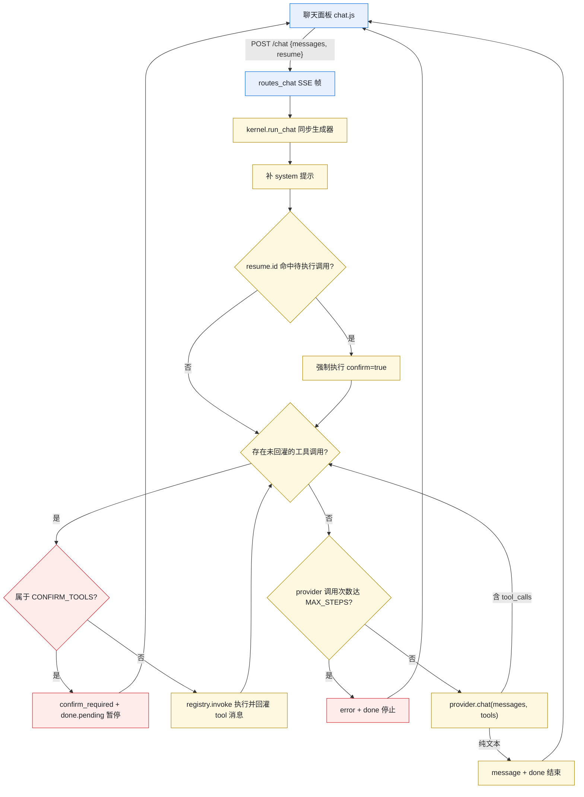

# 内置智能体内核设计说明书

冻结版本：卡B（P1-23）W3 · 2026-11-16 · 契约基线 [AGENT-CONTRACT.md](AGENT-CONTRACT.md) v1（21 工具）。
本文是内置智能体（内核 + 聊天面板 + Provider 聊天适配）的唯一设计真源；实现偏离须同步回写本文。

## 1. 定位与范围

### 1.1 选定方案与理由

选定「内核只做编排、能力真源仍在 registry」：`app/agent/kernel.py` 驱动 LLM 经
`registry.invoke` 操作 vault，不新增任何能力语义。理由：卡A 已把 21 工具收敛为单一契约，
内置智能体与外部 Agent（Verbot）共用同一真源才能保证行为 parity；内核另起能力集会造成双真源漂移。

放弃方案：内核直连 VaultService（绕过契约校验与 journal 收口）——破坏 actor 归因与 schema 边界，弃。

### 1.2 组件与传输

| 组件 | 文件 | 职责 |
|------|------|------|
| 内核 | `app/agent/kernel.py` | tool-calling 循环、confirm 拦截、resume、名字净化、事件流 |
| 聊天路由 | `app/api/routes_chat.py` | `POST /api/agent/chat` SSE 帧封装，线程池迭代同步生成器 |
| Provider 聊天适配 | `app/agent/provider.py` `chat()` | OpenAI function-calling 请求/响应规范化 |
| 聊天面板 | `static/js/chat.js` | 历史携带、SSE 消费、步骤渲染、确认对话框、就绪态 |

信任边界：`/chat` 与 organize / provider-config 同为本地 UI 端点，**不设 token**（服务绑定
127.0.0.1）；外部 Agent 走带 token 的 `POST /api/agent/tool`。UI 确认闸门防的是 **LLM 自主越权**，
不是本地恶意客户端——本地进程本就可用 admin token 调 `/tool` 并自填 confirm，二者信任级等价。

## 2. 对话循环

### 2.1 循环结构



### 2.2 无状态服务端

服务端不保存对话：每轮请求由客户端携带完整 `messages`；`done` 事件回传内核追加后的
`messages` 与 `pending`（暂停时）。客户端下一轮原样回传，resume 仅带被批准调用的 `id`。
理由：进程重启/多标签不丢会话语义，且与 REST 无状态风格一致；放弃服务端 session 表（新增存储与过期治理，无收益）。

### 2.3 步数上限

`MAX_STEPS = 8` 计 **provider.chat 调用次数**（工具执行与 resume 不计）。达到上限发
`error`（文案含上限值）+ `done` 停止，防模型自循环烧 token。选定 8：覆盖「搜索→阅读→写→复查」
典型链（4 次）留一倍余量；更大值无实测收益。

## 3. 工具暴露与名字净化

OpenAI function name 不允许 `.`，故对 LLM 暴露净化名，回调经 `name_map` 映射回真名：

| 真名（契约） | LLM 名 | 映射方向 |
|--------------|--------|----------|
| `kwey.search` | `kwey_search` | 暴露时 replace('.', '_') |
| `kwey.graph.query` | `kwey_graph_query` | 回调时 name_map 反查 |
| `kwey.trash.purge` | `kwey_trash_purge` | 同上 |

`parameters` 直接取契约 `input_schema`（JSON Schema 子集），校验仍由 `registry._validate`
在 invoke 内执行——内核不做第二套校验。未知净化名反查失败时按原名 invoke，由契约抛 404 回灌模型。

## 4. 确认闸门

### 4.1 闸门工具表

| 工具 | side_effect | 暂停理由 |
|------|-------------|----------|
| `kwey.history.rollback` | reversible | 覆盖当前正文（回滚前自动快照兜底） |
| `kwey.trash.purge` | irreversible | 永久删除，不可恢复 |
| `kwey.organize.apply` | reversible | 批量结构化写盘 |
| `kwey.dir.delete` | reversible | 结构性删除；内核一律 gated（比 REST 非空 409 更严） |

### 4.2 拦截与续跑规则

- LLM 自填 `confirm=true` **一律忽略**：闸门判定只看工具名，暂停发 `confirm_required` + `done.pending`。
- 用户允许：客户端回传 `done.messages` + `resume={"id"}`；内核对该调用强制 `confirm=true` 执行，随后继续循环。
- 用户拒绝：客户端追加 `role:tool` 消息（content 为 `{"code":1,"message":"用户拒绝了此操作"}`）回传，
  内核视该调用已回灌，交模型作答拒绝后果。**拒绝不写盘、不留 journal。**
- `resume.id` 不在待执行集合时静默忽略，循环回到闸门重新暂停（不会误执行其它调用）。
- 闸门暂停时**不发 tool_call**；前端由 `confirm_required` 自渲染等待步骤条（同 id 在 resume 后复用）。

## 5. actor 与 journal

内核固定 `BUILTIN_ACTOR = {"role":"admin","name":"kwey-built-in"}`，经 `registry.invoke(actor=…)`
收口留痕：写工具按契约 `journal_action` 记 `.kwey/agent-journal.jsonl`（organize.apply 逐 path）。
进程内 trusted 故 admin；危险操作仍由 UI 闸门把关。脉冲面板 ACTION_LABEL 已覆盖全部 14  action。

## 6. SSE 事件契约

帧格式：`data: <JSON>\n\n`（`ensure_ascii=False`）。媒体类型 `text/event-stream`，
头 `Cache-Control: no-cache`、`X-Accel-Buffering: no`。vault 未打开在流开始前抛 400。

| type | 载荷 | 客户端动作 |
|------|------|------------|
| `tool_call` | id, name(真名), arguments | 渲染运行中步骤条 |
| `tool_result` | id, name, ok, data, error | 步骤条转 ✓/✗，失败附 error |
| `confirm_required` | id, name, arguments, reason | 渲染等待步骤条 + askConfirm |
| `message` | content | 助手气泡（空内容不渲染） |
| `error` | message | 错误气泡（字段名是 message，非 error） |
| `done` | messages, pending | 更新本地历史；pending 非空走确认流 |

漏网异常由路由兜底成 `error` + `done` 帧，不抛穿流。同步生成器经 Starlette 线程池迭代，
urllib 阻塞不占事件循环。

## 7. Provider 聊天适配

`AgentProvider.chat(messages, tools)`：仅 `openai` 协议（`http` 协议抛 ProviderError，
整理指令路径 `run()` 不受影响）；POST `<endpoint>/chat/completions`（endpoint 已含后缀不重复拼），
body = `{model, messages, tool_choice:"auto", tools?}`，Bearer api_key。
`_parse_chat` 取 `choices[0].message`：content str|null；tool_calls 规范化为
`[{id,name,arguments:dict}]`（arguments JSON 串解析失败抛 ProviderError 含工具名）。
ProviderError 消息**绝不回显 api_key**（HTTP 错误只含状态码）。配置读 `.kwey/provider.json`，
损坏静默回退默认值；设置页经既有 `GET/PUT /api/agent/provider-config`（key 打码、掩码回写保留）。

## 8. 前端面板职责

`static/js/chat.js`（右栏「助手」，ribbon i-spark / 命令面板「打开内置智能体聊天」）：
历史由 `done.messages` 续带；步骤条状态 run/ok/err/wait 同 id 复用；确认走 dialog.js askConfirm
（danger 红钮）；未配置或非 openai 协议显示横幅 + 「去设置」并禁用发送；停止=AbortController
中断 fetch（历史保留已发送 messages）；清空重置历史；Enter 发送 / Shift+Enter 换行。
助手气泡为纯文本 pre-wrap（**不做 markdown 渲染**，防注入面与依赖膨胀）；全部输出 escapeHtml。
写盘后的树刷新依赖 WS created/updated 事件 + done 后 tree-refresh。

## 9. 验证与已知限制

### 9.1 测试矩阵

| 层 | 文件 | 规模 |
|----|------|------|
| 内核单测（mock provider） | `tests/test_agent_kernel.py` | 21 |
| 全量回归 | `py -m pytest -q` | 585 |
| W1 真 urllib 冒烟 | `.workbuddy/b_w1_smoke.py` | 18/18 |
| W2 浏览器 E2E（桩 Provider + msedge） | `.workbuddy/chat_e2e.py` | 25/25 |

### 9.2 复现命令

```
py -m pytest tests/test_agent_kernel.py -q
py .workbuddy/b_w1_smoke.py
py .workbuddy/chat_e2e.py
```

冒烟/E2E 均自包含：克隆 vault + 桩 OpenAI 服务 + 独立端口后端子进程，不触碰用户 live 服务。

### 9.3 已知限制

- 停止按钮未实测（桩响应瞬时，流来不及中断）；中断后历史保留已发送 messages，下轮可续。
- 助手气泡纯文本，不渲染 markdown。
- 真实 LLM endpoint 未验证（全部证据来自桩 Provider）；openai 兼容面以 Chat Completions + tools 为准。
- 客户端断连后当前工具步骤仍会执行完（同步生成器在 yield 间隙才感知断连）。