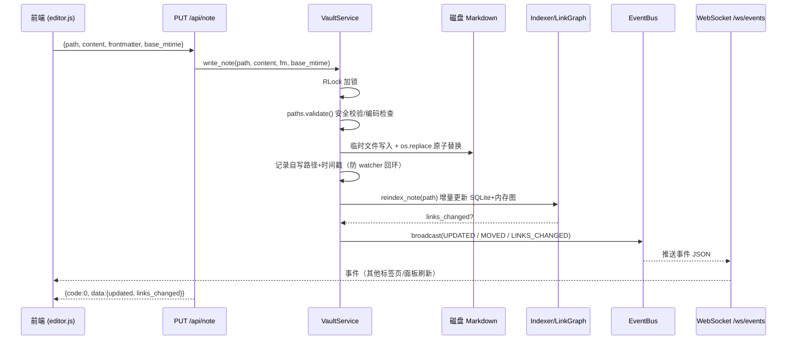
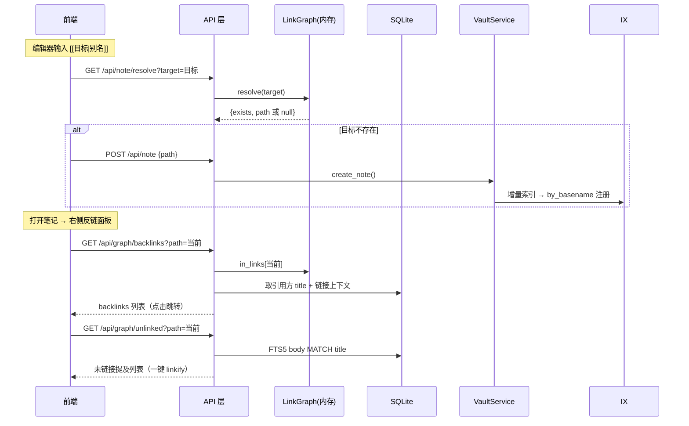
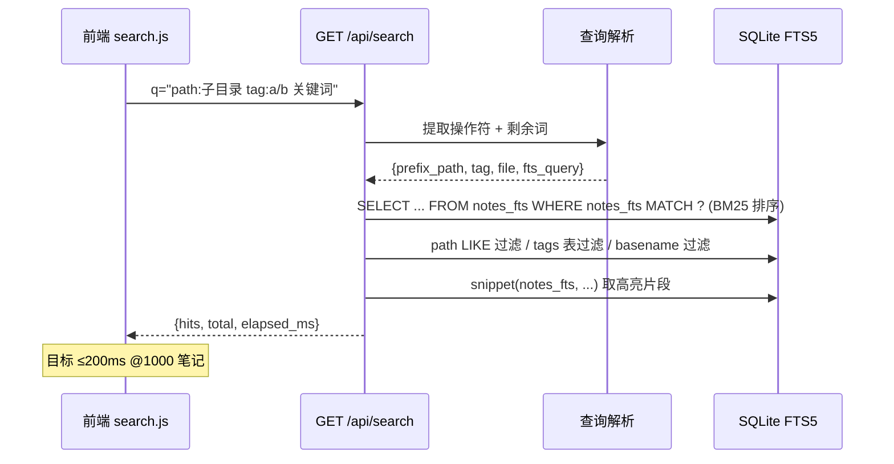
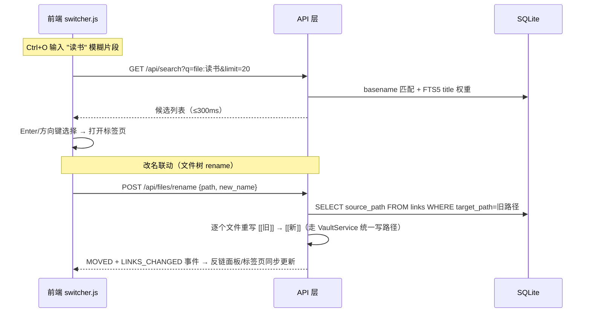

# Kwey M1 架构设计与任务分解

> 版本：v1.0 ｜ 撰写：高见远（架构师）｜ 上游：`DESIGN.md`（技术栈定稿）、`docs/PRD.md`（验收标准）
> 本轮范围 = **M1：P0 全部 13 项**。M2（MCP/Agent Link）、M3（图谱/向量检索）只预留架构位置，不实现。

---

## 1. 实现方案概述与框架选型确认

### 1.1 核心技术挑战

| 挑战 | 对策 |
|---|---|
| 磁盘 = 唯一事实源，SQLite 仅索引可重建 | 索引层与存储层严格分离：`app/index/` 只读磁盘构建索引；任何写操作不直接触碰 SQLite |
| 多入口写（UI 编辑、文件树操作、外部编辑器/watchfiles）竞争 | **VaultService 统一写路径**：`加锁 → 写盘（原子写）→ 防抖重索引 → 广播事件`，UI 与未来 Agent 共用（G5） |
| watchfiles 自写文件回环 | VaultService 写盘后记录「最近自写路径+时间戳」，watcher 命中自写集合则跳过重索引 |
| 改名/移动全库 0 断链 | links 表记录原始 wikilink 文本 → 移动时按「该笔记的全部引用方」重写正文（`app/vault/links.py`） |
| 1000 笔记搜索 ≤200ms | FTS5 虚表 + BM25，操作符在查询前由 Python 解析为结构化过滤，避免全表扫描 |
| Windows 中文路径/文件名 | 统一路径工具模块：全程 `pathlib` + UTF-8 显式编码；URL 中 path 一律 vault 相对正斜杠路径 + encodeURIComponent；文件名非法字符过滤 |
| 无 npm 构建链的前端编辑器 | CodeMirror 6 从 cdnjs 下载 UMD/ESM 单文件包本地化到 `static/vendor/`；下载失败降级为带行号+语法高亮的增强 textarea（任务 T07 内含降级分支） |

### 1.2 框架选型（确认 DESIGN.md 定稿，不引入新依赖）

- **后端**：Python 3.13 / FastAPI + uvicorn（REST + WebSocket + 静态托管）；markdown-it-py + python-frontmatter（解析）；watchfiles（监听）；sqlite3 内置 FTS5（索引）。
- **桌面壳**：pywebview（WebView2）。`main.py` 支持 `--server` 纯浏览器模式：跳过 pywebview，仅起 uvicorn，便于测试与 QA。
- **前端**：原生 HTML/CSS/JS 模块化（ES Module），无构建链；CodeMirror vendored。
- **架构模式**：后端分层 `API 层 → Service 层（VaultService）→ 索引层（Indexer/LinkGraph）→ 磁盘`；事件总线 `EventBus` 为内存 pub/sub，M1 内部使用，M2 直接对 WS/SSE 暴露。
- **M2/M3 预留**：`app/agent/`（空包占位）、settings 中预留 provider/向量配置区块（前端灰置）；FTS5 混合排序接口在 `routes_search.py` 预留 `mode=hybrid` 参数位。

---

## 2. 完整目录结构与文件列表

```
Kwey/
├── main.py                     # 唯一入口：解析 --server/--vault 参数，启动 uvicorn（并按模式起 pywebview）
├── requirements.txt            # 依赖声明
├── app/
│   ├── __init__.py
│   ├── config.py               # 应用配置：.kwey/settings.json 读写、默认值（附件目录/主题/防抖参数）
│   ├── paths.py                # 路径工具：vault 相对路径↔绝对路径、安全校验、Windows 非法字符、UTF-8 规范
│   ├── models.py               # Pydantic 模型：API 请求/响应体、NoteMeta、SearchHit、VaultEvent
│   ├── events.py               # EventBus：内存 pub/sub，事件类型枚举 created/updated/deleted/moved/links_changed
│   ├── server.py               # FastAPI app 工厂：路由注册、静态文件挂载、CORS（--server 模式）
│   ├── parser/
│   │   ├── __init__.py
│   │   ├── frontmatter.py      # YAML frontmatter 解析/写回（保留未知字段与正文原样）
│   │   ├── wikilink.py         # [[目标]] / [[目标|别名]] / ![[嵌入]] 的提取与解析（区分 embed）
│   │   ├── tags.py             # 行内 #tag / #a/b 嵌套标签提取（跳过代码块与 frontmatter）
│   │   └── renderer.py         # markdown-it-py 渲染 HTML（预览服务端兜底 + wikilink 渲染插件）
│   ├── index/
│   │   ├── __init__.py
│   │   ├── database.py         # SQLite 连接管理（WAL）、建表 DDL、FTS5 虚表、整库重建
│   │   ├── indexer.py          # 全量扫描 + 单文件增量索引（notes/links/tags/fts 同步更新）
│   │   └── linkgraph.py        # 内存链接图：邻接表、反链查询、按 basename 解析、未链接提及候选
│   ├── vault/
│   │   ├── __init__.py
│   │   ├── service.py          # VaultService：统一写路径（锁→原子写盘→增量索引→广播）、读接口
│   │   ├── watcher.py          # watchfiles 防抖监听 → 自写去重 → 增量索引 → 广播外部变更事件
│   │   └── links.py            # 改名/移动时全库链接重写、删除进 .trash/、嵌入与附件路径同步
│   └── api/
│       ├── __init__.py
│       ├── deps.py             # 依赖注入：vault 单例、config、eventbus 获取
│       ├── routes_system.py    # vault 打开/信息、设置读写、附件上传、health
│       ├── routes_notes.py     # 笔记读取/创建/保存/删除、wikilink 解析、frontmatter 属性
│       ├── routes_files.py     # 文件树、新建/改名/移动/删除（走 VaultService + links 重写）
│       ├── routes_search.py    # 全文搜索 + path:/tag:/file: 操作符（预留 hybrid 参数位）
│       ├── routes_graph.py     # 反向链接、未链接提及、标签树、标签对应笔记
│       └── ws.py               # /ws/events：EventBus → WebSocket 广播（M2 对 agent 复用）
├── static/
│   ├── index.html              # 应用骨架：三栏布局 + 浮层 + 设置页 DOM
│   ├── css/
│   │   ├── themes.css          # 亮/暗主题 CSS 变量（P0-13 核心）
│   │   ├── layout.css          # 三栏、标签栏、状态栏布局
│   │   ├── editor.css          # 编辑器与预览样式
│   │   ├── panels.css          # 左右面板、文件树、浮层样式
│   │   └── base.css            # reset、字体、滚动条、通用组件
│   ├── vendor/
│   │   └── codemirror/         # vendored CodeMirror 6 单文件包（下载失败则此目录缺省，走降级）
│   └── js/
│       ├── app.js              # 入口：初始化各模块、绑定快捷键、WS 订阅分发
│       ├── api.js              # fetch 封装（统一 {code,data,message}）+ WS 客户端 + 重连
│       ├── state.js            # 前端状态：打开标签栈、激活标签、设置、事件订阅表
│       ├── tabs.js             # 多标签页：开/关/切/恢复（localStorage 持久化）
│       ├── editor.js           # 编辑器：CodeMirror 集成或增强 textarea 降级、防抖自动保存
│       ├── preview.js          # 实时预览：调后端渲染 + wikilink/嵌入/标签/标题渲染与点击跳转
│       ├── filetree.js         # 文件树渲染与新建/改名/移动/删除操作
│       ├── tagpanel.js         # 标签层级树面板
│       ├── backlinks.js        # 反向链接 + 未链接提及面板（含一键转双链）
│       ├── search.js           # 搜索面板 UI + 操作符输入 + 高亮结果
│       ├── switcher.js         # Ctrl+O 快速切换器浮层
│       ├── palette.js          # Ctrl+P 命令面板浮层（命令注册表）
│       ├── properties.js       # frontmatter 属性区展示与编辑
│       ├── attachments.js      # 粘贴/拖入图片 → 上传 → 插入相对链接
│       ├── settings.js         # 设置页：主题切换、附件目录、vault 管理（M2/M3 区块灰置）
│       └── utils.js            # 防抖、模糊匹配评分、路径处理、转义
├── tests/
│   ├── conftest.py             # pytest fixtures：临时 vault、TestClient
│   ├── test_parser.py          # frontmatter/wikilink/tags/renderer 单测
│   ├── test_indexer.py         # 建索引、增量更新、整库重建单测
│   ├── test_linkgraph.py       # 反链、basename 解析、未链接提及单测
│   ├── test_vault_service.py   # 统一写路径、并发锁、事件广播单测
│   ├── test_links_rewrite.py   # 改名/移动 0 断链、trash 删除单测
│   ├── test_watcher.py         # 外部改动增量索引、自写去重单测
│   ├── test_api_notes.py       # 笔记 CRUD/文件树 API 集成测试
│   └── test_api_search.py      # 搜索操作符 + 1000 笔记性能基准测试
└── docs/
    ├── ARCHITECTURE.md         # 本文档
    ├── PRD.md                  # 产品需求文档
    ├── sequence-diagram.mermaid
    └── class-diagram.mermaid
```

文件总数：后端 24 + 前端 22 + 测试 10 + 根 2 ≈ **58 个**。

---

## 3. 核心数据结构

### 3.1 SQLite 表结构（全部可整库重建，文件 `.kwey/index.db`）

```sql
-- 笔记元数据（不存正文，正文以磁盘为准）
CREATE TABLE notes (
    path     TEXT PRIMARY KEY,        -- vault 相对路径，正斜杠，如 "notes/读书.md"
    title    TEXT NOT NULL,           -- frontmatter.title 或文件名
    mtime    REAL NOT NULL,           -- 磁盘 mtime，增量索引用
    size     INTEGER NOT NULL,
    created  TEXT,                    -- frontmatter.created（ISO 8601）
    updated  TEXT                     -- frontmatter.updated
);

-- 标签（frontmatter 与行内合并存储，来源区分）
CREATE TABLE tags (
    note_path TEXT NOT NULL,
    tag       TEXT NOT NULL,          -- 完整嵌套路径 "a/b"
    source    TEXT NOT NULL,          -- 'frontmatter' | 'inline'
    PRIMARY KEY (note_path, tag, source)
);

-- 链接（含双链与嵌入；target 为原始文本，target_path 为解析结果可 NULL=断链）
CREATE TABLE links (
    source_path TEXT NOT NULL,
    target      TEXT NOT NULL,        -- [[ ]] 内原始文本（含别名分隔前的部分）
    target_path TEXT,                 -- 解析后的 vault 路径，NULL=未解析
    kind        TEXT NOT NULL,        -- 'wikilink' | 'embed'
    line        INTEGER,              -- 所在行号（跳转用）
    PRIMARY KEY (source_path, target, kind, line)
);

-- FTS5 全文虚表（external content 关联 notes? 否——独立存索引副本，重建简单）
CREATE VIRTUAL TABLE notes_fts USING fts5 (
    path UNINDEXED,
    title,
    body,
    tags,
    tokenize = 'unicode61 remove_diacritics 2'
);

-- 索引元信息（索引版本号，便于将来 schema 迁移时判定重建）
CREATE TABLE meta (key TEXT PRIMARY KEY, value TEXT);
```

### 3.2 内存链接图（`linkgraph.py`，进程内单例，随索引同步）

```python
out_links:  dict[str, set[str]]    # 源笔记路径 → 解析后目标路径集合
in_links:   dict[str, set[str]]    # 目标路径 → 引用方路径集合（反链 O(1)）
by_basename: dict[str, set[str]]   # 文件名去 .md → 路径集合（wikilink 解析第二优先级）
```

- 解析优先级：精确相对路径 → basename 全局匹配（大小写不敏感，Windows 语义）→ 未解析。
- 未解析链接在目标创建/改名后由 indexer 增量「复活」：仅重解析受影响路径相关的链接。
- 未链接提及：以当前笔记 title（去 .md）在 FTS5 `body` 中 MATCH，剔除 `in_links` 已含者。

### 3.3 frontmatter 字段约定

```yaml
---
title: 笔记标题            # 可选，缺省用文件名
tags: [a, b/c]            # 可选，list[str]，支持嵌套
created: 2026-11-12T10:00:00   # ISO 8601，创建时由 VaultService 自动补
updated: 2026-11-12T12:30:00   # 保存时自动刷新
aliases: []               # 预留（M3 图谱/切换器增强），M1 解析但不特殊处理
<任意自定义字段>            # 原样保留写回，不丢不排序
# ---- 写入溯源管理字段（kwey_ 命名空间，宿主生成，普通 UI 只读）----
kwey_writer_kind: human   # human / agent / system / unknown；不信任模型自报值
kwey_last_writer: local-ui # local-ui / kwey-built-in / mcp-stdio / token 名 / duty:inbox
kwey_run_id: chat:1a2b3c  # 可选批次；未提供则不写，不制造假关联
kwey_generated: false     # 当前语义版本含 Agent 派生内容（具粘性）
kwey_reviewed_at: 2026-11-25T10:00:00+08:00  # 仅单独审阅动作设置
kwey_reviewed_hash: <sha256>  # 人工确认时的 payload hash
kwey_hash_version: 1      # payload 序列化规则版本；版本不符一律不算已审
---
```

- 写回策略：只替换被编辑的字段，YAML 序列化后重新拼接，正文与注释性内容不动（`python-frontmatter` 天然满足）。
- `kwey_*` 由 VaultService 统一写路径自动注入/刷新；payload hash = 正文 + 业务 frontmatter（排除 `created`/`updated` 与全部 `kwey_*`）的稳定序列化 SHA-256。
  序列化规则变化必须升 `kwey_hash_version`，旧版本 hash 不得被误判为当前已审。
- 管理字段只是可携带声明：是否「已审当前版本」必须以本机 `.kwey/provenance.json` 基线核对为准；无基线时状态为 `unknown`（声明未校验）。

### 3.4 事件类型枚举（`events.py`，与 DESIGN.md 推送格式对齐）

```python
class EventType(str, Enum):
    CREATED       = "created"        # 新建笔记/附件
    UPDATED       = "updated"        # 内容/属性变更
    DELETED       = "deleted"        # 删除（进 .trash/）
    MOVED         = "moved"          # 改名/移动（payload 携带 old_path/new_path）
    LINKS_CHANGED = "links_changed"  # 链接图变化（重写链接后、或被引用关系变化）
    INDEX_READY   = "index_ready"    # 首次扫描/整库重建完成

# 广播格式：{"event": "...", "path": "...", "old_path": "...", "ts": 1699...}
```

---

## 4. REST / WS API 接口表

**统一约定**：前缀 `/api`；响应格式 `{"code": 0, "data": ..., "message": "ok"}`，错误 `code` 非 0（400 参数错 / 404 不存在 / 409 路径冲突 / 500 内部错），FastAPI 层统一包装；`path` 参数一律 vault 相对路径（正斜杠，UTF-8，URL 编码）；所有写操作走 VaultService。

### 4.1 系统（routes_system.py）

| 方法 | 路径 | 入参 | 出参 data |
|---|---|---|---|
| GET | `/api/health` | — | `{status:"ok", vault:"...", indexed:N}` |
| POST | `/api/vault/open` | `{path: 绝对路径}` | `{name, path, note_count, tag_count}`（触发全量索引，INDEX_READY 后返回） |
| GET | `/api/vault/info` | — | 同上（当前 vault 状态与索引状态） |
| GET | `/api/tree` | — | 嵌套树 `[{name, path, type:"dir"\|"note", children:[...]}]`（隐藏 `.kwey/` `.trash/` `.git/`） |
| GET | `/api/settings` | — | `{theme, attachment_dir, editor_mode, ...}` |
| PUT | `/api/settings` | 部分字段 | 更新后的 settings（持久化 `.kwey/settings.json`） |
| POST | `/api/attachments` | multipart 文件 | `{path: "attachments/xxx.png"}`（重名自动追加序号） |
| GET | `/attachments/...` 等静态 | — | FastAPI StaticFiles 直出附件与图片预览 |

### 4.2 笔记（routes_notes.py）

| 方法 | 路径 | 入参 | 出参 data |
|---|---|---|---|
| GET | `/api/note` | `?path=` | `{path, title, content, frontmatter, mtime}` |
| POST | `/api/note` | `{path, content?, frontmatter?}` | 新笔记 meta（已存在→409） |
| PUT | `/api/note` | `{path, content, frontmatter, base_mtime?}` | `{updated, links_changed:bool}`（base_mtime 不符→409 冲突提示） |
| DELETE | `/api/note` | `?path=` | `{trash_path}`（移动进 `.trash/`） |
| GET | `/api/note/resolve` | `?target=` | `{exists, path, title}`（wikilink 解析；不存在时前端提示创建） |
| GET | `/api/note/render` | `?path=` | `{html}`（服务端 markdown-it 渲染，含 wikilink/嵌入/标签，预览兜底） |
| GET | `/api/note/embed` | `?path=` | `{html, exists}`（`![[..]]` 嵌入内容块） |

### 4.3 文件管理（routes_files.py）

| 方法 | 路径 | 入参 | 出参 data |
|---|---|---|---|
| POST | `/api/files/create-note` | `{dir, name}` | 新笔记 meta（VaultService 生成，冲突自动去重） |
| POST | `/api/files/create-dir` | `{dir, name}` | `{path}` |
| POST | `/api/files/rename` | `{path, new_name}` | `{new_path, rewritten_links:N}`（自动全库链接重写，广播 MOVED+LINKS_CHANGED） |
| POST | `/api/files/move` | `{path, new_dir}` | 同上 |
| DELETE | `/api/files/dir` | `?path=` | 整目录进 `.trash/`（非空需 `?confirm=1`） |

### 4.4 搜索（routes_search.py）

| 方法 | 路径 | 入参 | 出参 data |
|---|---|---|---|
| GET | `/api/search` | `?q=关键词 [path:子目录] [tag:a/b] [file:名]&limit=50&mode=fts` | `{hits:[{path, title, score, snippet(含 <mark> 高亮), tags}], total, elapsed_ms}`（预留 `mode=hybrid` 参数位，M3 接 Chroma） |

操作符解析：`path:`/`tag:`/`file:` 前缀提取后转结构化过滤（path 用 LIKE 前缀匹配、tag 查 tags 表、file 用 basename 匹配），剩余词进 FTS5 MATCH（BM25）。

### 4.5 图/标签（routes_graph.py）

| 方法 | 路径 | 入参 | 出参 data |
|---|---|---|---|
| GET | `/api/graph/backlinks` | `?path=` | `{backlinks:[{path, title, snippet(链接上下文), line}], count}` |
| GET | `/api/graph/unlinked` | `?path=` | `{mentions:[{path, title, snippet, line}]}`（含本笔记 title 的未建链文本） |
| POST | `/api/graph/linkify` | `{path, mention_path, line?}` | 在提及处创建 `[[..]]`（走统一写路径） |
| GET | `/api/graph/tags` | — | 层级树 `[{name:"a", count:N, children:[{name:"a/b", count:N}]}]` |
| GET | `/api/graph/tag-notes` | `?tag=a/b` | `[{path, title}]`（frontmatter 与行内合并） |

### 4.6 WebSocket（ws.py）

| 端点 | 说明 |
|---|---|
| `WS /ws/events` | 订阅 EventBus；消息即 §3.4 事件 JSON；心跳 ping/pong；M1 前端消费，M2 对 agent 复用（届时加 token 鉴权字段位） |

---

## 5. 关键调用流程（时序图）

> 完整 4 张图已另存 `docs/sequence-diagram.mermaid`，此处为同步副本。

### 5.1 统一写路径（所有写操作唯一通道）



### 5.2 双链解析与反向链接查询



### 5.3 全文搜索（含操作符）



### 5.4 快速切换（Ctrl+O）与文件改名联动



---

## 6. M1 任务列表（有序，含依赖与验收要点）

> 依赖尽量收敛到 T01，T02–T05 后端可并行推进；T06–T09 前端按模块独立；T10 收尾集成。

### T01 项目骨架与基础设施
- **涉及文件**：`main.py`、`requirements.txt`、`app/__init__.py`、`app/config.py`、`app/paths.py`、`app/models.py`、`app/events.py`、`app/server.py`、`app/api/__init__.py`、`app/api/deps.py`、`static/index.html`（骨架）、`static/css/base.css`、`static/js/app.js`（空壳）、`tests/conftest.py`
- **内容**：入口与 `--server` 模式、FastAPI 工厂 + 静态托管、config/paths/events/models 底座、`/api/health`
- **验收**：`python main.py --server` 启动后 `/api/health` 200；静态页可访问；中文路径 vault 校验函数单测通过

### T02 Markdown 解析器
- **涉及文件**：`app/parser/__init__.py`、`app/parser/frontmatter.py`、`app/parser/wikilink.py`、`app/parser/tags.py`、`app/parser/renderer.py`、`tests/test_parser.py`
- **依赖**：T01
- **验收**：frontmatter 解析↔写回往返无损（自定义字段保留）；`[[a]]`/`[[a|b]]`/`![[a]]` 提取正确（含行号）；行内标签跳过代码块；renderer wikilink 输出带 data 属性的 HTML

### T03 SQLite 索引与内存链接图
- **涉及文件**：`app/index/__init__.py`、`app/index/database.py`、`app/index/indexer.py`、`app/index/linkgraph.py`、`tests/test_indexer.py`、`tests/test_linkgraph.py`
- **依赖**：T01, T02
- **验收**：全量索引 + 单文件增量索引正确；删除 `.kwey/index.db` 后重建功能完整（G4）；FTS5 BM25 查询与 snippet；反链/basename 解析/未链接提及候选正确

### T04 VaultService 统一写路径 + 监听 + 链接重写（G5 核心）
- **涉及文件**：`app/vault/__init__.py`、`app/vault/service.py`、`app/vault/watcher.py`、`app/vault/links.py`、`tests/test_vault_service.py`、`tests/test_links_rewrite.py`、`tests/test_watcher.py`
- **依赖**：T01, T02, T03
- **验收**：写路径 = 锁→原子写→增量索引→广播；watchfiles 外部改动仅增量更新受影响索引且自写不回环；改名/移动后被 5 处引用的笔记全库 0 断链；删除进 `.trash/`；并发写无竞态

### T05 REST/WS API 完整层
- **涉及文件**：`app/api/routes_system.py`、`app/api/routes_notes.py`、`app/api/routes_files.py`、`app/api/routes_search.py`、`app/api/routes_graph.py`、`app/api/ws.py`、`tests/test_api_notes.py`、`tests/test_api_search.py`
- **依赖**：T04
- **验收**：§4 全部接口按统一 `{code,data,message}` 返回；WS 事件推送可达；1000 笔记搜索（含操作符）≤200ms；linkify 一键转双链可用

### T06 前端壳：三栏布局 + 标签页 + 主题
- **涉及文件**：`static/index.html`、`static/css/base.css`、`static/css/layout.css`、`static/css/themes.css`、`static/js/app.js`、`static/js/api.js`、`static/js/state.js`、`static/js/tabs.js`、`static/js/utils.js`
- **依赖**：T01（可并行 T05）
- **验收**：三栏 + 顶标签栏 + 底状态栏布局（可折叠侧栏）；多标签开/关/切；标签页持久化、重启恢复（P0-11）；暗/亮 CSS 变量即时切换并持久化（P0-13 前端侧）；WS 连接与事件分发骨架

### T07 编辑器、预览、属性与附件
- **涉及文件**：`static/js/editor.js`、`static/js/preview.js`、`static/js/properties.js`、`static/js/attachments.js`、`static/js/settings.js`、`static/css/editor.css`、`static/vendor/codemirror/`（下载脚本或本地化文件）
- **依赖**：T06, T05
- **验收**：CodeMirror vendored 集成（**降级分支**：下载失败自动切换增强 textarea，行号+基础高亮保留，其余功能不受影响）；源码/实时预览切换光标保持（P0-2）；双链/别名/嵌入渲染与点击跳转、断链点击提示创建（P0-3）；frontmatter 属性区编辑写回（P0-10）；粘贴/拖入图片入 attachments 并插相对链接（P0-12）；防抖自动保存走 PUT /api/note

### T08 左右面板：文件树 / 标签 / 反链
- **涉及文件**：`static/js/filetree.js`、`static/js/tagpanel.js`、`static/js/backlinks.js`、`static/css/panels.css`
- **依赖**：T06, T05
- **验收**：文件树新建/改名/移动/删除走 API 且界面即时同步 WS 事件（P0-7）；标签层级树点击过滤（P0-5）；反链列表 + 未链接提及 + 一键转双链（P0-4）

### T09 搜索 / 快速切换器 / 命令面板 / 设置页
- **涉及文件**：`static/js/search.js`、`static/js/switcher.js`、`static/js/palette.js`、`static/js/settings.js`（若 T07 未含）、`static/css/panels.css`（浮层样式增补）
- **依赖**：T06, T05
- **验收**：搜索面板支持 `path:`/`tag:`/`file:` 与结果高亮跳转（P0-6）；Ctrl+O 模糊切换 ≤300ms、键盘导航（P0-8）；Ctrl+P 命令注册表 + 模糊匹配 + 快捷键提示（P0-9）；设置页主题/附件目录/vault 管理（P0-13）

### T10 集成收尾与性能验证
- **涉及文件**：全模块联调（改动集中在 `static/js/app.js`、`app/server.py`、各测试文件）、`tests/test_api_search.py`（性能基准）、`docs/` 验收记录
- **依赖**：T07, T08, T09
- **验收**：G1–G5 全指标过 PRD 验收标准：500+ 笔记既有 vault 导入正确、1000 笔记搜索 ≤200ms、删索引重启恢复 0 丢失、改名 0 断链、写路径/事件总线成型

### 占位条目（不展开、不实现）
- **T11 (M2) Agent Link**：MCP Server（FastMCP sidecar）、WS/SSE 对外事件、Provider 适配器、git 快照、token 鉴权——复用 EventBus 与 VaultService，预留位 `app/agent/`。
- **T12 (M3) 体验补全**：D3 图谱、大纲面板、模板、每日笔记、Chroma 混合搜索（`mode=hybrid` 接口位已留）。

---

## 7. requirements.txt 完整内容

```text
# Kwey M1 依赖（Python 3.13 / Windows；安装统一使用 python -m pip install -r requirements.txt）

fastapi>=0.115.0          # REST + WS + 静态托管
uvicorn[standard]>=0.30.0 # ASGI 服务器（standard 含 websockets/watchfiles 加速）
pywebview>=5.1            # 桌面壳（Windows 走 Edge WebView2；--server 模式不加载）
markdown-it-py>=3.0.0     # Markdown 渲染
python-frontmatter>=1.1.0 # YAML frontmatter 解析/写回（自带 PyYAML 依赖）
watchfiles>=0.24.0        # 文件监听（防抖）
PyYAML>=6.0               # frontmatter 依赖显式声明

# 开发/测试
pytest>=8.0.0
httpx>=0.27.0             # FastAPI TestClient 依赖
```

---

## 8. 共享知识 / 跨文件约定

1. **命名规范**：Python 模块 snake_case、类 PascalCase；前端 JS 文件小写无连字符外一律 kebab 不适用——统一小写单词（`filetree.js`）；CSS 类名 BEM 简化式 `block--modifier`。
2. **路径约定（最重要）**：API 与前端传递的 `path` 一律为 **vault 相对路径、正斜杠 `/`、不含 vault 根**，如 `notes/读书/2026计划.md`；绝对路径只在 `paths.py` 内部转换，任何模块不得手工拼 `\\`。安全校验：拒绝 `..`、盘符、保留名（CON/NUL 等）、控制字符；文件名非法字符 `< > : " | ? *` 过滤。
3. **统一写路径**：任何进程内代码（UI API、未来的 agent）写 vault 必须经 `VaultService`，禁止直接 `open()`/`Path.write_text()`；读操作可直接读盘但元数据以索引为准。
4. **错误处理**：后端抛 `HTTPException(code, message)` 由 `server.py` 统一包装为 `{code, data:null, message}`；前端 `api.js` 统一拦截非 0 code 并 toast；409 冲突（mtime 不符/重名）由前端提示覆盖或重命名。
5. **事件总线用法**：生产方只调 `EventBus.publish(VaultEvent)`；消费方 `subscribe(handler)`；WS 层是 M1 唯一对外出口；事件 **只描述发生了什么**（path/type），不携带全文——消费方按需回读 API。
6. **前后端数据交互**：响应一律 `{code, data, message}`；日期 ISO 8601 字符串（本地时间带偏移）；布尔/枚举用 snake_case 字段名；分页用 `limit`（默认 50，搜索/切换器均适用）。
7. **编码**：所有文件 I/O 显式 `encoding="utf-8"`（含 BOM 容忍读取）；SQLite 连接 `text_factory` 默认 str；HTML 响应头 charset=utf-8。
8. **测试约定**：pytest fixtures 在 `conftest.py` 提供临时 vault 生成器（含中文文件名、嵌套目录、frontmatter 样例）；API 测试用 `TestClient`；性能测试独立标记 `@pytest.mark.perf`。
9. **降级分支**：`static/vendor/codemirror/` 缺失时 `editor.js` 检测 `window.KweyVendorOK` 标志自动切增强 textarea，功能面（保存/预览/双链）不缩水。

---

## 9. 待明确事项（默认假设，不阻塞实现）

1. **单 vault**：首启引导选择 vault 目录，不做多 vault 并存管理（PRD §8.1）。
2. **嵌入图片全局解析**：`![[图.png]]` 按文件名全库匹配附件（含 attachments/），与 `[[..]]` 同一解析器优先级（PRD §8.4 待定项，按此实现，M1 内可调）。
3. **标签页恢复**：恢复全部打开标签 + 激活页（存 localStorage）；成本超预期则降级为仅激活页（PRD §8.3 允许）。
4. **断链视觉**：红色虚线渲染，点击弹出「创建笔记」确认浮层；视觉细节由实现时对齐三栏风格。
5. **`file:` 操作符语义**：匹配文件名（含扩展名省略），走 basename + title 双通道后合并去重，保证切换器复用。
6. **性能基准口径**：1000 笔记、平均 500 字/篇、单层冷缓存首次查询后的稳态查询 ≤200ms。
7. **pywebview 与 --server 共存**：同一 uvicorn 实例，`--server` 仅决定是否创建 pywebview 窗口；默认端口 17630（避开常见占用），可 `--port` 覆盖。
8. **CodeMirror vendored 范围**：仅核心 + markdown 语言包 + 少量扩展（历史/搜索），从 cdnjs 一次性下载；总量预期 <500KB。

---

*本架构文档为 P3 实现（寇豆码）与 P4 测试（严过关）的唯一技术依据；变更须经里程碑评审。*
